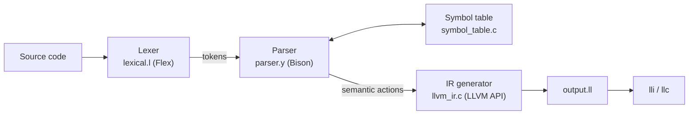

# C Compiler with Flex, Bison and LLVM

**An educational compiler for a C-like language, built from scratch with Flex (lexer), Bison (parser), and the LLVM C++ API (code generation).** It turns source code into LLVM IR that runs directly with `lli`, and it shows every core phase of compiler construction in a small codebase you can read in one sitting.


---

## Table of contents

- [Why this project](#why-this-project)
- [Features](#features)
- [Quick start](#quick-start)
- [Example](#example)
- [How it works](#how-it-works)
- [Project structure](#project-structure)
- [Project status](#project-status)
- [Roadmap](#roadmap)
- [FAQ](#faq)
- [Contributing](#contributing)
- [License](#license)

---

## Why this project

Most compiler tutorials stop at parsing, or they jump straight to a full production compiler. This project sits in between: a **complete front end plus real LLVM code generation**, small enough to understand end to end. It's useful for:

- **Students** in a compiler construction or compiler design course
- **Developers** learning how **Flex and Bison** work together in practice
- **Anyone** who wants a hands-on introduction to **generating LLVM IR** with `IRBuilder`

## Features

**Language**
- Types: `int`, `float`, `bool`, `void`
- Global and local variables, one-dimensional arrays with compile-time bounds checks for constant indices
- Functions with parameters and return values; prototypes, which may leave out parameter names (`int add(int, int);`)
- Arithmetic `+ - * / %` and unary minus (`-x`), relational `< <= > >= == !=`, logical `&& || !`, increment and decrement `++ --`
- Control flow: `if`/`else` and `else if` chains (conditions may be any int, float or bool, like C), `while`, `for`, `switch`/`case`/`default` (fallthrough, grouped and negative labels), `break`, `continue`, `return`
- I/O: `printf`, `scanf`. `printf` accepts a real C format string (`printf("x=%d\n", x)`) or a simple label style (`printf("Sum: ", sum)` prints `Sum: 15` and a newline)

**Compiler phases**
- **Lexical analysis** with Flex: keywords, identifiers, literals, operators, comments
- **Syntax analysis** with Bison: LALR(1) grammar with operator precedence and associativity
- **Semantic analysis**: scoped symbol table, undeclared and redeclared identifier detection, type checking, function call argument checking
- **Code generation**: LLVM IR through the LLVM C++ API, verified and written to `output.ll`

## Quick start

### Prerequisites

| Tool | Purpose |
|---|---|
| `flex` | Lexer generator |
| `bison` | Parser generator |
| `g++` | C++ compiler |
| LLVM 14 (`llvm-config`, `lli`) | IR library and interpreter |

On **Ubuntu / Debian / WSL**:

```sh
sudo apt install flex bison g++ llvm-14 llvm-14-dev
```

### Build and run

```sh
git clone https://github.com/<coderafay>/c-compiler-flex-bison-llvm.git
cd c-compiler-flex-bison-llvm
make                                   # builds ./compiler
./compiler testCaseExamples/test.c     # writes output.ll
lli output.ll; echo $?                 # runs the program, prints main's return value
```

If the program has any syntax, semantic, or type errors, `./compiler` prints them, exits with status 1, and writes no `output.ll`.

Run `make clean` to remove all build artifacts.

## Example

**Input** (`example.c`):

```c
int main() {
    int a = 6;
    int b = 7;
    return a * b;
}
```

**Generated LLVM IR** (`output.ll`):

```llvm
define i32 @main() {
entry:
  %a = alloca i32, align 4
  store i32 6, i32* %a, align 4
  %b = alloca i32, align 4
  store i32 7, i32* %b, align 4
  %a1 = load i32, i32* %a, align 4
  %b2 = load i32, i32* %b, align 4
  %multmp = mul i32 %a1, %b2
  ret i32 %multmp
}
```

**Run it:**

```sh
$ ./compiler example.c && lli output.ll; echo $?
42
```

**Semantic errors** are reported with line numbers:

```c
int main() {
    int x = y + 2;   // y was never declared
    return x;
}
```

```
Semantic Error: Variable 'y' not declared (line 2)
Type Error: Cannot assign incompatible type to 'x' (line 2)
```

## How it works



1. **Lexical analysis.** `lexical.l` defines token patterns. Flex generates `lex.yy.c`, which turns raw characters into tokens like `INT`, `IDENTIFIER`, `NUMBER`, and `PLUS`.
2. **Syntax analysis.** `parser.y` defines the grammar. Bison generates an LALR(1) parser. Precedence declarations (`%left`, `%right`, `%nonassoc`) resolve operator ambiguity and the dangling `else`.
3. **Semantic analysis.** As grammar rules are reduced, semantic actions look up and insert identifiers in a scoped symbol table, check types, and validate function calls.
4. **Code generation.** The same actions call `llvm_ir.c`, which uses LLVM's `IRBuilder`. Each local variable becomes an `alloca`; reads and writes become `load` and `store`; expressions map to LLVM instructions. The module is verified and written to `output.ll`.

## Project structure

```
.
├── lexical.l            # Flex lexer specification
├── parser.y             # Bison grammar, semantic actions, main()
├── symbol_table.c/.h    # Scoped symbol table
├── llvm_ir.c/.h         # LLVM IR code generation
├── Makefile             # Build rules
└── testCaseExamples/    # Sample input programs
```

## Project status

This is an active learning project. The front end is complete; code generation is partly done.

| Area | Status |
|---|---|
| Lexer | ✅ Working |
| Parser | ✅ Working |
| Semantic analysis | ✅ Working |
| IR: expressions, variables, assignment | ✅ Working and verified with `lli` |
| IR: functions (params, calls, prototypes) | ✅ Working and verified with `lli` |
| IR: global variables | ✅ Working and verified with `lli` |
| IR: `printf` (format strings, labels, int/float/bool) | ✅ Working and verified with `lli` |
| IR: `if` / `else` / `else if` (nested, early `return`) | ✅ Working and verified with `lli` |
| IR: `while` / `for` (nested, `for (int i ...)` scoped to the loop) | ✅ Working and verified with `lli` |
| IR: `switch` (fallthrough, grouped labels, `case -1:`, `default` anywhere, nested) | ✅ Working and verified with `lli` |
| Arrays (`int a[10]`, `a[i]`, local and global) | ✅ Working and verified with `lli` |

## Roadmap

- [x] Fix control flow code generation (`if`/`else`, `while`, `for`, `switch`)
- [x] Accept negative `case` labels (`case -1:`) in the `switch` rewrite
- [x] `break`/`continue` inside loops (with the `switch` rewrite, which makes `break` a normal statement)
- [ ] Automated test suite (`make test`) with expected outputs
- [ ] Hide debug output behind a `-v` flag
- [x] Stop writing IR when semantic errors occur
- [ ] Optimization passes (mem2reg, constant folding)
- [ ] Native executables via `llc` and the system linker
- [x] String support in `printf`

## FAQ

**What is this project?**
An educational compiler for a subset of C. It's written in C++ with Flex, Bison, and LLVM, and it compiles source code to LLVM IR.

**How do Flex and Bison work together?**
Flex produces `yylex()`, which returns one token at a time. Bison's generated `yyparse()` calls `yylex()` repeatedly and matches the tokens against grammar rules. Token values are passed through `yylval`, and token IDs are shared through `parser.tab.h`.

**Why generate LLVM IR instead of assembly?**
LLVM IR is portable and strongly typed, and LLVM can optimize it. The same IR can be interpreted with `lli`, optimized with `opt`, or compiled to native code for any target with `llc`. That lets the project focus on front-end concepts.

**Is this a full C compiler?**
No. It supports a teaching-sized subset of C: no pointers, structs, or preprocessor. Use GCC or Clang for real C code.

**Which LLVM version is required?**
LLVM 14. Other versions may need small API changes.

**Can I use this for my compiler construction course?**
Yes. It's meant as a learning reference. Please follow your institution's academic integrity rules.

## Contributing

Contributions are welcome, especially fixes on the [roadmap](#roadmap).

1. Fork the repo and create a branch: `git checkout -b fix/while-loop-codegen`
2. Make a focused change, then rebuild and test: `make clean && make && ./compiler <file> && lli output.ll; echo $?`
3. Open a pull request that describes what you changed and how you tested it.

Bug reports with a minimal input program are very helpful.

## License

Released under the [MIT License](LICENSE).

---

If this project helped you learn about compilers, consider giving it a ⭐. It helps others find it.
